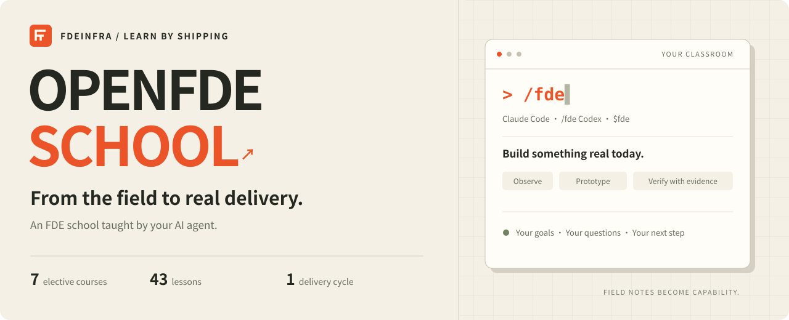

<p align="center"><a href="README.md">简体中文</a> &nbsp; | &nbsp; <strong>English</strong></p>

<p align="center">
  
</p>

<h1 align="center">OpenFDE School</h1>

<p align="center">Practice delivering enterprise AI you can actually verify, inside your AI coding tool.</p>

<p align="center">
  <a href="#start-learning">Start learning</a> ·
  <a href="#choose-your-path">Choose your path</a> ·
  <a href="references/lab-guide.md">Hands-on lab</a> ·
  <a href="WALL.md">Learner wall</a> ·
  <a href="CONTRIBUTING.en.md">Contribute</a>
</p>

<p align="center">
  <a href="manifest.json"></a>
  <a href="https://github.com/FDEInfra/OpenFDE-SCHOOL/actions/workflows/validate.yml"></a>
  <a href="references/lab-guide.md"></a>
  <a href="https://github.com/FDEInfra/OpenFDE-SCHOOL/stargazers"></a>
</p>
<p align="center">
  <a href="#start-learning"></a>
  <a href="#start-learning"></a>
  <a href="LICENSE"></a>
  <a href="LICENSE"></a>
</p>

---

A **Forward Deployed Engineer (FDE)** works alongside customers to put AI into the workflows people actually use. Here, your Agent acts as a tutor: it explains the ideas, helps you observe a business, define the scope, build a solution, and check the results against real evidence.

The curriculum is distilled from the **OpenFDE × Guancha FDE learning cohort**. It is designed for people exploring FDE work and practitioners improving how they deliver enterprise AI. [Watch the original courses ↗](https://openfde.net/zh/resources/guancha-fde)

**Language:** this README and the contribution guide are available in English and Chinese. Course materials, exercise templates, and community forms are currently primarily in Chinese.

| Follow your goals | Learn by doing | Keep evidence of your progress |
| :--- | :--- | :--- |
| Every course is elective; start where you need to | Business observations, SOWs, Skills, APIs, and evaluation sets | Inspect real files and command output before marking work complete |
| Ask questions, then return to the lesson | Practice in a local simulated business environment | Save progress locally and pick up where you left off |

## Start learning

### 1 · Install in your tool

You need **Git, Python 3.9+**, and a working installation of Claude Code or Codex. This repository is public; downloading and installing it does not require a GitHub account.

Send the appropriate prompt to your Agent:

**Claude Code**

```text
Check that Git and Python 3.9+ are available.
Install https://github.com/FDEInfra/OpenFDE-SCHOOL.git into ~/.claude/skills/fde.
If the directory exists, inspect origin and local changes first. Preserve all uncommitted work.
For a clean checkout of the former official repository, Alan-Youngzhe/OpenFDE-School,
update origin to the new URL. Run git pull --ff-only only for a clean checkout of the
same official project; otherwise stop and explain why.
Run python3 ~/.claude/skills/fde/scripts/validate_school.py and report the actual output.
```

**Codex**

```text
Check that Git and Python 3.9+ are available.
Install https://github.com/FDEInfra/OpenFDE-SCHOOL.git into ~/.agents/skills/fde.
If the directory exists, inspect origin and local changes first. Preserve all uncommitted work.
For a clean checkout of the former official repository, Alan-Youngzhe/OpenFDE-School,
update origin to the new URL. Run git pull --ff-only only for a clean checkout of the
same official project; otherwise stop and explain why.
Run python3 ~/.agents/skills/fde/scripts/validate_school.py and report the actual output.
```

<details>
<summary>Manual installation and updates (macOS / Linux / Windows)</summary>

On macOS / Linux, install into Claude Code with one command:

```bash
curl -fsSL https://raw.githubusercontent.com/FDEInfra/OpenFDE-SCHOOL/main/scripts/install.sh | bash
```

The default destination is `~/.claude/skills/fde`. For Codex, use:

```bash
curl -fsSL https://raw.githubusercontent.com/FDEInfra/OpenFDE-SCHOOL/main/scripts/install.sh | OPENFDE_SCHOOL_DIR="$HOME/.agents/skills/fde" bash
```

Windows PowerShell:

```powershell
# For Codex, first set: $env:OPENFDE_SCHOOL_DIR = Join-Path $HOME '.agents\skills\fde'
irm https://raw.githubusercontent.com/FDEInfra/OpenFDE-SCHOOL/main/scripts/install.ps1 | iex
```

Run the same installation command to update. The installer recognizes the former official repository and migrates its origin after checking for local changes. Updates use fast-forward merges only. It stops for unrelated repositories, non-Git directories, or uncommitted changes.

For ZIP installations, place the contents in the appropriate `fde` directory. Back up and compare any existing files first. ZIP installations cannot be updated with Git.

Installer source: [Bash](scripts/install.sh) · [PowerShell](scripts/install.ps1).

</details>

### 2 · Open a new session and start

| Claude Code | Codex |
| :--- | :--- |
| `/fde` | `$fde` |
| `/fde I want to deliver AI projects for clients` | `$fde I choose course ③` |
| `/fde continue` | `$fde continue` |

On your first visit, the tutor shows the catalog, learns about your goals, and helps you choose a course. When you return, it reads your saved progress, checks existing work, and resumes the unfinished task.

Progress is saved in `~/.openfde-school/me.json` by default. Course resources stay in the skill installation directory; exercises live in your own project directory. When moving computers, bring both your progress file and your exercise files. For a separate progress directory, tell the tutor which directory to use or set `OPENFDE_SCHOOL_STATE_DIR`.

## Choose your path

All courses are elective. Numbers ①–⑤ and ⑦ follow the source curriculum; ⑧ identifies the bonus course. They are stable identifiers, not a mandatory sequence.

| Your goal | Start here | What you produce |
| :--- | :--- | :--- |
| Understand FDE work and identify valuable business needs | [① FDE landscape and enterprise discovery](references/courses/fde-landscape.md) | Business observations, opportunity assessment, and a problem definition |
| Turn a vague request into a deliverable project | [② Scoping, CLI workflow, and your first prototype](references/courses/scope-cli-prototype.md) | A statement of work (SOW) and a working prototype |
| Turn business know-how into an Agent capability | [③ Skills in enterprise practice](references/courses/skills-in-enterprise.md) | A reusable Skill and verification evidence |
| Connect an Agent to internal business systems | [④ Enterprise integration with CLI](references/courses/cli-enterprise-integration.md) | Read/write operations, validation, idempotency, and recovery |
| Prepare a demo for real-world use | [⑤ Evals and the path from demo to production](references/courses/evals-to-production.md) | An evaluation set, failure analysis, and release gates |
| Understand what a finished project looks like | [⑦ Demo Day and standout learner projects](references/courses/demoday.md) | Review notes based on five learner projects |
| Prepare for jobs, a portfolio, or independent consulting | [⑧ FDE careers, portfolios, and entrepreneurship](references/courses/fde-career.md) | Role assessment, a portfolio plan, and next steps |

New to FDE? Start with **①**. Already have a business scenario? Try **②**. Have a working demo but need confidence before delivery? Choose **⑤**. See the [course catalog](references/catalog.md) and [curriculum coverage](references/coverage.md) for details.

## Practice on a business workflow

Courses ②–⑤ share an **expense pre-review lab** with 12 fictional records. Start with policy rules, then connect to a local HTTP API, package a CLI, perform controlled writes, and build an evaluation set. The lab has no third-party dependencies, requires no enterprise account, and makes no paid model calls.

From the repository root (Python 3.9+):

```bash
python3 assets/enterprise-lab/lab.py init --workspace work/expense-demo
python3 assets/enterprise-lab/lab.py eval --workspace work/expense-demo --output work/current.json
```

[Open the lab guide →](references/lab-guide.md) · [View a sample SOW →](assets/templates/expense-sow.md)

If you cannot run the lab, use the paper exercises and mark actual integration and automation as unverified. Completing the curriculum does not establish externally validated production readiness, teaching effectiveness, or professional competence.

## Record your first milestone

A business observation, an SOW, a Skill, an evaluation set, a demo, or a completed client engagement is worth documenting.

Create a [learner wall Issue](https://github.com/FDEInfra/OpenFDE-SCHOOL/issues/new?template=join-wall.yml), then submit a PR to [WALL.md](WALL.md) with anonymized evidence and a one-sentence reflection. The wall is waiting for its first entry.

Found a sticking point or an error? [Send course feedback](https://github.com/FDEInfra/OpenFDE-SCHOOL/issues/new?template=course-feedback.yml). To contribute lessons, experiments, or tooling, read the [contribution guide](CONTRIBUTING.en.md).

<details>
<summary>Repository structure and local checks</summary>

```text
SKILL.md                   Tutor rules and course routing
manifest.json              Version, source, and package file list
references/courses/        Teaching guides for 7 courses
references/lessons/        43 lessons and 2 shared learning nodes
references/lab-guide.md    Hands-on lab guide
assets/enterprise-lab/     Local API, CLI, policies, and evaluation data
assets/templates/          SOW, SPEC, handover, and portfolio examples
WALL.md                    Learner milestones
```

```bash
python3 scripts/validate_school.py
python3 scripts/validate_wall.py
python3 scripts/validate_lab.py
python3 scripts/validate_install.py
```

Checks cover the package manifest, relative links, course routing, common secret patterns, learner wall, simulated enterprise lab, and installer migration behavior. Test actual onboarding, course selection, and session resumption separately using the [conversation validation guide](references/learning-flow-checks.md).

</details>

## Sources and licensing

The school adapts the cohort's talks into lessons, exercises, and acceptance criteria. Cohort awards, prizes, and interview opportunities remain subject to the original event's terms. The school does not promise certificates or prizes. [Sources and attribution](references/sources.md)

Course Markdown is licensed under [CC BY-NC-SA 4.0](https://creativecommons.org/licenses/by-nc-sa/4.0/); code and automation use MIT. Original cohort content and third-party materials retain their respective licenses. See [LICENSE](LICENSE) for the full terms.
