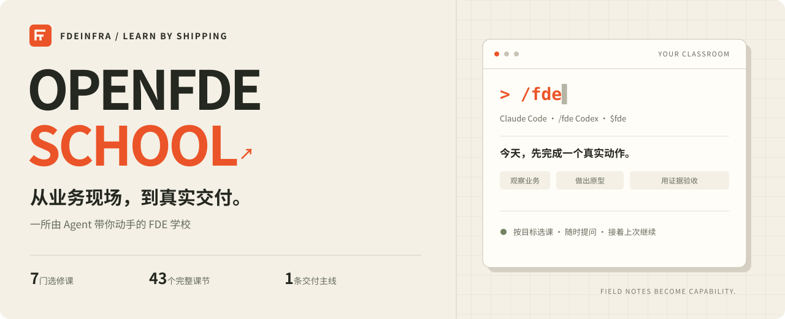

<p align="center"><strong>简体中文</strong> &nbsp; | &nbsp; <a href="README.en.md">English</a></p>

<p align="center">
  
</p>

<h1 align="center">OpenFDE School · FDE 学校</h1>

<p align="center">在你的 AI 编程工具里，练会一次可验收的企业 AI 交付。</p>

<p align="center">
  <a href="#开始上课">开始上课</a> ·
  <a href="#按目标选课">按目标选课</a> ·
  <a href="references/lab-guide.md">实操实验</a> ·
  <a href="WALL.md">学员墙</a> ·
  <a href="CONTRIBUTING.md">参与共建</a>
</p>

<p align="center">
  <a href="manifest.json"></a>
  <a href="https://github.com/FDEInfra/OpenFDE-SCHOOL/actions/workflows/validate.yml"></a>
  <a href="references/lab-guide.md"></a>
  <a href="https://github.com/FDEInfra/OpenFDE-SCHOOL/stargazers"></a>
</p>
<p align="center">
  <a href="#开始上课"></a>
  <a href="#开始上课"></a>
  <a href="LICENSE"></a>
  <a href="LICENSE"></a>
</p>

---

FDE（Forward Deployed Engineer，前线部署工程师）走进客户的业务现场，把 AI 接进真正有人使用的工作流程。这所学校让 Agent 做你的导师：讲清原理，带你观察业务、界定范围、动手构建，再用真实输出验收。

内容蒸馏自 **OpenFDE ✖️ 观猹 FDE 共学营**，适合想入行 FDE 的学习者，也适合正在做企业 AI 交付、想补齐方法的从业者。[观看原课程 ↗](https://openfde.net/zh/resources/guancha-fde)

| 按你的目标学 | 在真实动作里学 | 留下可核对的证据 |
| :--- | :--- | :--- |
| 全部选修，直接进入需要的课程 | 观察记录、SOW、Skill、API、评估集 | 看真实文件和命令输出，再记录完成 |
| 随时提问，答完回到主线 | 配套本地模拟企业实验 | 自动存档，下次接着上课 |

## 开始上课

### 1 · 安装到你的工具

需要 **Git、Python 3.9+**，以及已可用的 Claude Code 或 Codex。仓库公开，无需 GitHub 账号即可下载安装。

把对应的一段话发给你的 Agent：

**Claude Code**

```text
请检查 Git 和 Python 3.9+ 是否可用。
把 https://github.com/FDEInfra/OpenFDE-SCHOOL.git 安装到 ~/.claude/skills/fde。
已有目录时先检查 origin 和本地修改，保留所有未提交内容。
干净的旧官方仓库 Alan-Youngzhe/OpenFDE-School 可将 origin 改为新地址；
只有同源且干净的仓库才执行 git pull --ff-only，其它情况停止并说明原因。
运行 python3 ~/.claude/skills/fde/scripts/validate_school.py 并报告真实输出。
```

**Codex**

```text
请检查 Git 和 Python 3.9+ 是否可用。
把 https://github.com/FDEInfra/OpenFDE-SCHOOL.git 安装到 ~/.agents/skills/fde。
已有目录时先检查 origin 和本地修改，保留所有未提交内容。
干净的旧官方仓库 Alan-Youngzhe/OpenFDE-School 可将 origin 改为新地址；
只有同源且干净的仓库才执行 git pull --ff-only，其它情况停止并说明原因。
运行 python3 ~/.agents/skills/fde/scripts/validate_school.py 并报告真实输出。
```

<details>
<summary>手动安装与更新（macOS / Linux / Windows）</summary>

macOS / Linux，一行安装到 Claude Code：

```bash
curl -fsSL https://raw.githubusercontent.com/FDEInfra/OpenFDE-SCHOOL/main/scripts/install.sh | bash
```

默认安装到 `~/.claude/skills/fde`。Codex 用户使用：

```bash
curl -fsSL https://raw.githubusercontent.com/FDEInfra/OpenFDE-SCHOOL/main/scripts/install.sh | OPENFDE_SCHOOL_DIR="$HOME/.agents/skills/fde" bash
```

Windows PowerShell：

```powershell
# Codex 用户先设置：$env:OPENFDE_SCHOOL_DIR = Join-Path $HOME '.agents\skills\fde'
irm https://raw.githubusercontent.com/FDEInfra/OpenFDE-SCHOOL/main/scripts/install.ps1 | iex
```

重复运行同一安装命令即可更新。安装器识别旧官方仓库，检查本地改动后迁移来源，更新只接受快进合并。遇到其它来源、非 Git 目录或本地改动时停止。使用已下载的 ZIP 时，将内容放入对应的 `fde` 目录；已有目录先备份、比对，ZIP 安装不支持 Git 更新。

安装器源文件：[Bash](scripts/install.sh) · [PowerShell](scripts/install.ps1)。

</details>

### 2 · 新开会话，一句开课

| Claude Code | Codex |
| :--- | :--- |
| `/fde` | `$fde` |
| `/fde 我想接企业的单子` | `$fde 我选第③门` |
| `/fde 继续` | `$fde 继续` |

第一次，导师展示目录、了解你的目标，带你选课。再次进入，导师读取存档、核对已有产物，接着未完成的动作继续。

学习存档默认在 `~/.openfde-school/me.json`，课程留在技能安装目录，练习放在你的项目目录。换电脑时一并迁移存档与练习；需要独立存档时，告诉导师使用哪个目录，或设置 `OPENFDE_SCHOOL_STATE_DIR`。

## 按目标选课

所有课程均为选修。①–⑤、⑦沿用原资料课次，⑧为加餐课的目录编号，不代表必修顺序。

| 你现在想做什么 | 从这里开始 | 带走的成果 |
| :--- | :--- | :--- |
| 看懂 FDE，找到值得做的需求 | [① FDE 全景与企业需求挖掘](references/courses/fde-landscape.md) | 业务观察、需求判断与问题定义 |
| 把模糊需求变成能交付的项目 | [② 范围界定、CLI 工作流与首个原型](references/courses/scope-cli-prototype.md) | 一份 SOW 与首个原型 |
| 把业务经验变成 Agent 的能力 | [③ Skills 的企业实践](references/courses/skills-in-enterprise.md) | 可复用的 Skill 与验证证据 |
| 让 Agent 接入企业内部系统 | [④ CLI 打通企业内部系统](references/courses/cli-enterprise-integration.md) | 读写、校验、幂等与恢复流程 |
| 让 Demo 经得起真实使用 | [⑤ Evals 与从 Demo 到企业生产](references/courses/evals-to-production.md) | 评估集、故障定位与发布门槛 |
| 看懂好作品的完成标准 | [⑦ 结营与优秀项目 Demo Day](references/courses/demoday.md) | 对照 5 个学员项目的评审记录 |
| 准备求职、作品集或独立接单 | [⑧ FDE 求职、作品集与创业路径](references/courses/fde-career.md) | 岗位判断、作品集与下一步行动 |

不知道从哪开始，选 **①**；手上已有业务场景，选 **②**；Demo 已能运行但还不敢交付，选 **⑤**。完整内容见[课程目录](references/catalog.md)与[课程覆盖与产物](references/coverage.md)。

## 把课上到业务里

第②–⑤课共用一个**报销预审实验**：12 条虚构数据，从规则判断出发，逐步接入本机 HTTP API、封装 CLI、受控写回，再建立评估集。实验无第三方依赖，无需企业账号，不调用付费模型。

从仓库根目录开始（Python 3.9+）：

```bash
python3 assets/enterprise-lab/lab.py init --workspace work/expense-demo
python3 assets/enterprise-lab/lab.py eval --workspace work/expense-demo --output work/current.json
```

[打开实验指南 →](references/lab-guide.md) · [查看项目样例 →](assets/templates/expense-sow.md)

没有运行条件时可完成纸面演练；实际接入和自动调用仍记为未验证。课程训练完成也不等于已经获得真实企业部署、教学效果或职业能力的外部验证。

## 留下你的第一个里程碑

一次业务观察、一份 SOW、一个 Skill、一套评估集、一次 Demo、一次真实交付，都值得记录。

先创建[加入学员墙 Issue](https://github.com/FDEInfra/OpenFDE-SCHOOL/issues/new?template=join-wall.yml)，再向 [WALL.md](WALL.md) 提交 PR，附上脱敏证据和一句话复盘。当前学员墙等待第一份记录。

发现卡点或课程错误，可以[提交课程反馈](https://github.com/FDEInfra/OpenFDE-SCHOOL/issues/new?template=course-feedback.yml)；想贡献课程、实验或工具，请看[共建指南](CONTRIBUTING.md)。

<details>
<summary>项目结构与本地校验</summary>

```text
SKILL.md                   导师规则与课程路由
manifest.json              版本、来源与文件清单
references/courses/        7 门课程的教案
references/lessons/        43 个课节与 2 个共享节点
references/lab-guide.md    配套实验指南
assets/enterprise-lab/     本地 API、CLI、规则与评测数据
assets/templates/          SOW、SPEC、移交与作品样例
WALL.md                    学员里程碑
```

```bash
python3 scripts/validate_school.py
python3 scripts/validate_wall.py
python3 scripts/validate_lab.py
python3 scripts/validate_install.py
```

校验覆盖文件清单、相对链接、课程路由、常见密钥模式、学员墙、模拟企业实验和安装器迁移行为。导师实际入学、选课和续学行为，按[会话验证流程](references/learning-flow-checks.md)单独实测。

</details>

## 内容来源与许可

本校将共学营分享转化为课节、练习与验收。共学营当期的评选、奖品、面试直通等活动机制，以活动说明为准；本校不承诺证书或奖品。[课程来源与引用边界](references/sources.md)

课程 Markdown 使用 [CC BY-NC-SA 4.0](https://creativecommons.org/licenses/by-nc-sa/4.0/)，代码与自动化使用 MIT。共学营原始内容与第三方材料遵循各自许可，完整说明见 [LICENSE](LICENSE)。
